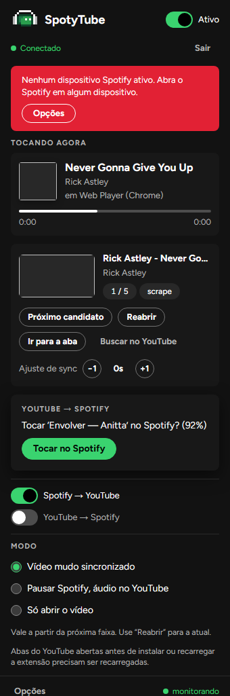
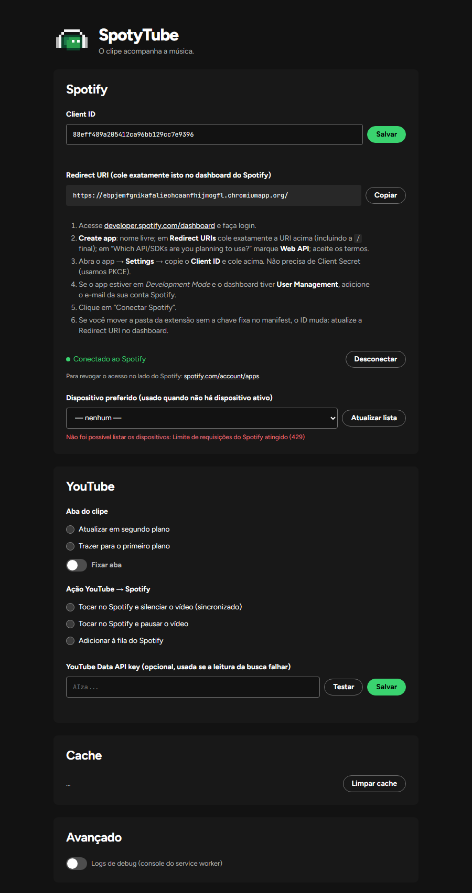

<p align="center">
  
</p>

<h1 align="center">SpotyTube</h1>

<p align="center">Extensão do Chrome que abre o videoclipe do que está tocando no Spotify e toca no Spotify o que você abre no YouTube.</p>

---

- **Spotify → YouTube (principal):** detecta a música que está tocando na sua conta Spotify, em qualquer dispositivo (app do computador, celular, web player), e abre o **videoclipe oficial** numa **única aba reutilizada** do YouTube. No modo padrão o vídeo fica **mudo e sincronizado** com o Spotify: posição, play/pause e avanço.
- **YouTube → Spotify (opcional):** quando você abre um clipe no YouTube, a extensão encontra a música correspondente e toca no Spotify.

JavaScript puro (ES modules), Manifest V3, sem build e sem dependências. A arquitetura completa está em [`docs/ARCHITECTURE.md`](docs/ARCHITECTURE.md).

<p align="center">
  
  &nbsp;&nbsp;
  
</p>

## Sumário

1. [Requisitos](#1-requisitos)
2. [Instalação](#2-instalação)
3. [Criar o app no Spotify](#3-criar-o-app-no-spotify)
4. [Configurar a extensão](#4-configurar-a-extensão)
5. [Como usar](#5-como-usar)
6. [Modos](#6-modos)
7. [Privacidade](#7-privacidade)
8. [Limitações](#8-limitações)
9. [Solução de problemas](#9-solução-de-problemas)
10. [Desenvolvimento](#10-desenvolvimento)
11. [Design system](#11-design-system)
12. [Estrutura do projeto](#12-estrutura-do-projeto)
13. [Notas de implementação](#13-notas-de-implementação)

## 1. Requisitos

- Google Chrome ou outro navegador Chromium (Edge, Brave, Opera), versão 116 ou mais nova.
- Uma conta **Spotify Premium**. Ler o que está tocando funciona em qualquer conta, mas tocar, pausar e adicionar à fila (usados no modo "Pausar Spotify" e no YouTube → Spotify) exigem Premium.
- Uma conta de desenvolvedor no Spotify (gratuita, é a mesma conta do Spotify) para criar o seu próprio app. Cada pessoa usa o próprio Client ID; não há servidor nem chave compartilhada.

## 2. Instalação

A extensão não está na Chrome Web Store. A instalação é pelo modo de desenvolvedor do Chrome:

1. Baixe o código:
   - com Git: `git clone https://github.com/vittorccf/spotytube.git`
   - ou pelo botão **Code → Download ZIP** no GitHub, e extraia o ZIP numa pasta fixa (não apague essa pasta depois).
2. Abra `chrome://extensions`.
3. Ligue o **Modo do desenvolvedor** (canto superior direito).
4. Clique em **Carregar sem compactação** e selecione a pasta que contém o `manifest.json`.
5. Fixe o ícone na barra: ícone de quebra-cabeça → alfinete ao lado do SpotyTube.

### ID fixo da extensão

O `manifest.json` tem o campo `"key"`, então o ID da extensão é o mesmo em qualquer computador e em qualquer pasta:

| | |
|---|---|
| ID da extensão | `ebpjemfgnikafalieohcaanfhijmogfl` |
| Redirect URI | `https://ebpjemfgnikafalieohcaanfhijmogfl.chromiumapp.org/` |

A página de opções sempre mostra a Redirect URI real em uso. Se aparecer outra, confira se o campo `"key"` continua no `manifest.json`.

### Atualizar

Com Git, rode `git pull` na pasta. Com ZIP, substitua os arquivos. Depois, em `chrome://extensions`, clique no botão de recarregar do SpotyTube e recarregue as abas do YouTube que estavam abertas.

## 3. Criar o app no Spotify

O SpotyTube conversa com a Web API do Spotify usando um app que **você** cria no painel de desenvolvedor:

1. Acesse <https://developer.spotify.com/dashboard> e entre com a **mesma conta** que você usa para ouvir música.
2. Clique em **Create app** e preencha:
   - **App name** e **App description**: qualquer texto (por exemplo, "SpotyTube pessoal").
   - **Redirect URIs**: cole exatamente `https://ebpjemfgnikafalieohcaanfhijmogfl.chromiumapp.org/` (com `https`, sem espaços e **com a barra no final**) e clique em **Add**.
   - Em **Which API/SDKs are you planning to use?**, marque **Web API**.
   - Aceite os termos e clique em **Save**.
3. Abra o app, vá em **Settings** e copie o **Client ID** (32 caracteres). O Client Secret **não** é necessário: a extensão usa PKCE.
4. Apps novos ficam em **Development Mode**. Se o painel tiver a aba **User Management**, adicione ali o seu nome e o **e-mail da sua conta Spotify**. Sem isso a API pode responder 403.

## 4. Configurar a extensão

1. Clique no ícone do SpotyTube → **Configurar** (ou botão direito no ícone → **Opções**).
2. Cole o **Client ID** e clique em **Salvar**.
3. Confira se a **Redirect URI** mostrada é a mesma cadastrada no app do Spotify (o botão **Copiar** ajuda).
4. Clique em **Conectar Spotify**, entre na sua conta se for pedido e clique em **Concordo**.
5. Abra `https://www.youtube.com` uma vez e aceite a tela de cookies, se aparecer.

Pronto. Dê play em algo no Spotify: em poucos segundos o clipe abre numa aba do YouTube.

### Outras opções

| Opção | O que faz |
|---|---|
| Dispositivo preferido | Onde tocar quando o YouTube → Spotify não encontra nenhum dispositivo ativo. Clique em **Atualizar lista** com o Spotify aberto em algum aparelho. |
| Aba do clipe | Atualizar em segundo plano (padrão) ou trazer para o primeiro plano a cada música. **Fixar aba** fixa a aba do SpotyTube. |
| Ação YouTube → Spotify | Tocar no Spotify e silenciar o vídeo (sincronizado), tocar e pausar o vídeo, ou só adicionar à fila. |
| YouTube Data API key | Opcional. Usada só se a leitura da página de busca do YouTube falhar. Pede a permissão opcional de `googleapis.com`. |
| Cache | Mostra quantos clipes estão guardados e permite limpar (inclui as escolhas feitas com "Próximo candidato"). |
| Logs de debug | Escreve logs detalhados no console do service worker. |

### Trocar de conta ou de app do Spotify

- **Desconectar** apaga o token salvo no navegador. No próximo **Conectar Spotify**, a tela do Spotify aparece de novo, e você pode entrar com outra conta.
- Trocar o **Client ID** desconecta automaticamente: o token pertence ao app antigo. Conecte de novo depois de salvar.

## 5. Como usar

### Popup

| Item | O que faz |
|---|---|
| Ativo / Pausado | Liga ou desliga tudo (atalho `Alt+Shift+S`). Pausado, a extensão não faz nenhuma chamada à API. |
| Tocando agora | Capa, música, artistas, dispositivo e progresso da faixa do Spotify. |
| Card do clipe | Miniatura, título, canal, candidato atual (por exemplo, `1 / 5`) e a origem da busca: `scrape` (página de busca do YouTube), `api` (Data API) ou `busca` (não achou um clipe confiável e abriu a página de resultados). |
| Próximo candidato | Descarta o vídeo atual e abre o próximo resultado (atalho `Alt+Shift+N`). A escolha fica salva para a próxima vez que essa música tocar. |
| Reabrir | Abre de novo o clipe da faixa atual (útil depois de trocar o modo ou fechar a aba). |
| Ir para a aba | Mostra a aba do clipe. |
| Buscar no YouTube | Abre a página de resultados da música na aba do SpotyTube. |
| Ajuste de sync −1 / +1 | No modo sincronizado, adianta ou atrasa o vídeo em 1 segundo para compensar introduções. O ajuste fica salvo por música. |
| Sugestão YouTube → Spotify | Aparece quando o vídeo aberto provavelmente é uma música, mas a confiança não é alta o bastante para tocar sozinho: "Tocar ‘Música — Artista’ no Spotify? (63%)". |
| Spotify → YouTube / YouTube → Spotify | Liga ou desliga cada direção. |
| Modo | Como o clipe abre. Vale a partir da próxima faixa; use **Reabrir** para aplicar na atual. |

### Atalhos de teclado

| Atalho | Ação |
|---|---|
| `Alt+Shift+S` | Ativar ou pausar o SpotyTube |
| `Alt+Shift+N` | Próximo candidato de clipe |

Para mudar os atalhos, abra `chrome://extensions/shortcuts`.

### Indicador no ícone

| Indicador | Significado |
|---|---|
| (vazio) | Tudo certo |
| `OFF` | Pausado |
| `!` | Erro, desconectado ou ainda não configurado |
| `?` | Não achou um clipe confiável e abriu a página de busca |

## 6. Modos

| Modo | O que acontece quando a música troca |
|---|---|
| **Vídeo mudo sincronizado** (padrão) | Abre o clipe mudo na mesma posição da música. Play, pause e avanço no Spotify, em qualquer dispositivo, aparecem no vídeo em poucos segundos; diferenças maiores que 2 s são corrigidas. Anúncios do YouTube não são pulados. Se você desmutar ou pausar o vídeo com o mouse ou o teclado, a extensão respeita. |
| **Pausar Spotify, áudio no YouTube** | Pausa o Spotify e toca o clipe **com som** a partir de onde a música estava. Se você voltar a tocar o Spotify, o vídeo pausa. |
| **Só abrir o vídeo** | Abre o clipe do começo, sem sincronizar nada. |

### YouTube → Spotify

Desligado por padrão. Quando ligado, ao assistir a um vídeo que parece música (categoria Music, canal VEVO ou "- Topic", "official video" no título), a extensão limpa o título, busca a faixa no Spotify e:

- com confiança de 72% ou mais, executa a ação configurada nas opções;
- entre 50% e 72%, mostra a sugestão no popup;
- abaixo de 50%, não faz nada.

Vídeos abertos pela própria extensão, o autoplay do YouTube e abas abertas em segundo plano não disparam o YouTube → Spotify.

## 7. Privacidade

- Não existe servidor do SpotyTube. Tudo roda no seu navegador.
- O token do Spotify fica em `chrome.storage.local`, no seu perfil do Chrome, e é enviado só para `api.spotify.com` e `accounts.spotify.com`.
- A extensão lê páginas públicas do `www.youtube.com` (busca e página do vídeo) para escolher o clipe. Com a Data API key configurada, consulta também `www.googleapis.com`.
- Nada é coletado, enviado ou compartilhado com terceiros.
- O Spotify não oferece um jeito de a extensão revogar o próprio acesso. "Desconectar" apaga o token local; para revogar no lado do Spotify, use <https://www.spotify.com/account/apps/>.

## 8. Limitações

- **Limite de requisições do Spotify.** Apps em Development Mode têm uma cota baixa. A extensão consulta o player a cada 5 s enquanto toca, 10 s pausado e 15 s sem dispositivo. Se o Spotify responder 429, toda chamada para aquele Client ID fica suspensa pelo tempo que o Spotify pedir (às vezes horas). O tempo restante aparece no popup e nas opções, e o bloqueio sobrevive a reiniciar o navegador. Veja [Solução de problemas](#9-solução-de-problemas).
- **Leitura da busca do YouTube.** A busca lê os dados da página de resultados. Se o YouTube mudar o HTML, a extensão usa a Data API (se configurada) ou abre a página de busca, e o popup avisa depois de 3 falhas seguidas.
- **Atraso.** A troca de música é detectada em até cerca de 5 s (perto do fim da faixa, quase na hora). Com o Spotify parado por 10 minutos, a extensão fica ociosa e volta a detectar em até 30 s depois do play.
- **Service worker do Manifest V3.** O loop se mantém vivo com um alarme de 30 s como reserva. Se o Chrome encerrar o service worker mesmo assim, o pior caso é cerca de 30 s de atraso.
- **Abas do YouTube abertas antes** de instalar ou recarregar a extensão não recebem o script; recarregue-as. A aba do SpotyTube sempre funciona.
- `music.youtube.com` e `m.youtube.com` não são suportados.
- **Autoplay com som** (modo "Pausar Spotify" com a aba em segundo plano) pode ser bloqueado pelo Chrome. O popup mostra o aviso com o botão **Ir para a aba**.
- Clipes com introdução longa ficam fora de sincronia até você usar o ajuste **−1 / +1** ou **Próximo candidato**.
- Faixas locais do Spotify abrem o clipe pela busca por nome e artista, mas o YouTube → Spotify nunca escolhe uma faixa local.
- No primeiro carregamento, o vídeo pode soar por uma fração de segundo antes de ser silenciado.

## 9. Solução de problemas

| Sintoma | Causa provável e solução |
|---|---|
| "Limite de requisições do Spotify atingido (429), aguarde X" | O app do Spotify estourou a cota. Espere o tempo indicado, ou crie outro app no painel (mesma Redirect URI), cole o novo Client ID, salve e conecte de novo. |
| Lista de dispositivos vazia ou "Dispositivo salvo (indisponível agora)" | Abra o Spotify em algum aparelho (app ou <https://open.spotify.com>) e clique em **Atualizar lista**. Os IDs de dispositivo mudam (o web player ganha um ID novo a cada sessão); se a mensagem embaixo da lista mostrar um erro, ele é a causa real. |
| "Nenhum dispositivo Spotify ativo" | O Spotify precisa estar aberto e ter tocado algo recentemente em algum aparelho. Escolha um **Dispositivo preferido** nas opções. |
| Erro `INVALID_CLIENT: Invalid redirect URI` no login | A Redirect URI do app no Spotify não é exatamente `https://ebpjemfgnikafalieohcaanfhijmogfl.chromiumapp.org/` (falta a barra final ou sobra um espaço). |
| 403 ao conectar ou ao tocar | Adicione o seu e-mail em **User Management** no app do Spotify. Tocar e pausar exigem Premium. |
| "Acesso ao Spotify revogado ou expirado" | O token foi revogado ou o Client ID mudou. Clique em **Conectar Spotify** de novo. |
| O clipe não abre | Confira se **Ativo** e **Spotify → YouTube** estão ligados e se o status no rodapé diz "monitorando". Abra o YouTube uma vez e aceite os cookies. |
| O vídeo não sincroniza | Recarregue a aba do YouTube (abas abertas antes de instalar a extensão não têm o script) ou clique em **Reabrir**. |
| Clipe errado | Clique em **Próximo candidato** (a escolha fica salva) ou em **Buscar no YouTube**. |

Para ver os logs: ligue **Logs de debug** nas opções, abra `chrome://extensions`, e no card do SpotyTube clique em **service worker**. `chrome://serviceworker-internals` mostra se o service worker está ativo.

## 10. Desenvolvimento

Não há build: edite os arquivos e recarregue a extensão em `chrome://extensions`. Para os testes basta o Node 20 ou mais novo, sem `npm install`.

```bash
npm test             # node --test "tests/**/*.test.js"
npm run check        # sintaxe de todos os .js, manifest, ícones, imports e referências
npm run icons        # regera icons/icon{16,32,48,128}.png a partir da logo em pixel art
npm run key          # gera ou lê a chave e atualiza o "key" do manifest
```

- Os testes cobrem o ranking de clipes, a detecção de troca de faixa, a normalização de texto, a leitura da busca do YouTube (com páginas reais em `tests/fixtures/`) e um teste de integração do service worker com `chrome.*` e `fetch` simulados. Detalhes em [`tests/README.md`](tests/README.md).
- A chave privada que corresponde ao `"key"` do manifest não está no repositório (`keys/` está no `.gitignore`). Ela só seria necessária para empacotar um `.crx` com o mesmo ID; para carregar sem compactação, não é necessária.
- Se você gerar uma chave nova com `npm run key`, o ID da extensão e a Redirect URI mudam. Atualize a Redirect URI no app do Spotify.

## 11. Design system

A interface segue o design system **SpotyTube**, inspirado em players de música escuros: fundo quase preto, cards levemente elevados, um verde de destaque (`#3ad36f`), botões em pílula e a fonte Figtree. A logo é a cabeça de um robô verde em pixel art com fone de ouvido.

- `src/shared/theme.css` concentra as fontes, as cores (tema escuro padrão e tema claro automático) e os componentes com prefixo `st-` (botões, switch, chips, status, alerta, barra de progresso, cards de faixa e clipe, campos e sugestão).
- `src/shared/fonts/` tem a Figtree e a JetBrains Mono (licença SIL Open Font License), empacotadas para a interface não depender da internet.
- `icons/logo.svg` é a logo; os PNGs de `icons/` são gerados dela por `tools/gen-icons.mjs`.
- Cores fixas da logo: robô `#2a9e4d` / `#1e7549` / `#0d462b`, olhos `#ffffff`, fone `#f5f5f5` / `#b3b3b3`.

## 12. Estrutura do projeto

```
manifest.json
icons/                   logo.svg e os PNGs da extensão
docs/                    ARCHITECTURE.md e capturas de tela
src/shared/              constants, messages, settings, text-normalize, log, theme.css, fonts/
src/background/          service-worker (entrada), state, poller, playback-tracker, controller,
                         spotify-auth (PKCE), spotify-api, youtube-html/-search/-watch-meta/-data-api,
                         clip-ranker, clip-finder, clip-cache, tab-manager, yt-to-spotify,
                         loop-guard, messaging, badge
src/content/youtube.js   script da página do YouTube: navegação SPA, anúncio, mudo, sincronia
src/popup/               popup da extensão
src/options/             página de opções
tests/                   testes (node --test) e páginas reais do YouTube
tools/                   gen-icons, gen-key, check
```

## 13. Notas de implementação

Decisões tomadas onde a arquitetura original era inviável, contraditória ou omissa:

1. **Bootstrap do service worker (§16).** O esboço chamava `boot()` antes de `let booted = null`, o que lança `ReferenceError` ao avaliar o módulo; `booted` é declarado antes. Como `boot()` é memoizado, os listeners chamam `wake()` = `boot()` + `ensureRunning()`.
2. **`node --test tests/`** não aceita diretório no Node 22+; o comando é `node --test "tests/**/*.test.js"` (`npm test`). O `package.json` existe só para esses scripts.
3. **Flags de `cleanSpotifyTitle` (§8.2)** são calculadas sobre o nome original, mas palavras que fazem parte do nome da música não contam (senão "Live Forever" viraria `live`). A mesma regra vale em `parseVideoTitle`.
4. **Canal "- Topic" (§8.6)** não recebe o bônus de "canal = artista", para respeitar a ordem exigida em §18.1 (oficial > lyric > áudio Topic).
5. **Rótulos de `reasons`** seguem o formato `'+oac 20'` / `'-lyrics 40'`.
6. **`scoreTrackMatch` e remix (§12.4/§18.1).** A fórmula foi mantida; o teste verifica que um remix indevido perde pelo menos 0,15 para a versão original, que é a escolhida.
7. **Endpoint de token.** Qualquer 400/401 no refresh (por exemplo, `invalid_client` depois de trocar o Client ID) é tratado como revogado; 429 e 5xx viram backoff.
8. **Login amarrado ao Client ID.** O token guarda o Client ID que o emitiu. Trocar o Client ID desconecta, e um token de outro app é ignorado.
9. **Bloqueio por 429.** O `Retry-After` do Spotify é gravado em `chrome.storage.local` junto com o Client ID, e nenhuma chamada à API sai até ele expirar, inclusive depois de reiniciar o navegador ou reconectar.
10. **`shouldRun`** também exige `clientId` configurado.
11. **`tabManager.navigate`** devolve uma promise que resolve com a aba, ou `null` se a navegação adiada foi substituída (a última vence).
12. **Aba que saiu do YouTube.** Se você levou a aba do SpotyTube para outro site, ela deixa de ser a aba do SpotyTube; a próxima música cria outra.
13. **`sendSync`** não envia a posição quando a faixa do Spotify é diferente da do clipe aberto, para não avançar o vídeo antigo com a posição da música nova.
14. **Script do YouTube.** O primeiro `playing` (gatilho do YouTube → Spotify) só é enviado depois que o service worker confirmou o vídeo; se a aba está oculta, é enviado quando ela fica visível. A re-imposição do mudo só vale no modo sincronizado.
15. **Elegibilidade do YouTube → Spotify** fica num mapa em memória por aba. Se o service worker morrer exatamente durante a espera de 2 s, aquele vídeo não dispara.
16. **`TRACK_RESTARTED` por fim de faixa** exige também `prev.progressMs > curr.progressMs`, para evitar falso positivo quando o Spotify reporta a duração levemente diferente.
17. **Campos extras:** `RuntimeState.spotyTabMode`, `currentClip.score/offsetMs/searchUrl`, `suggestion.tabId/trackId`, `UiState.playback.sampledAt` e `UiState.syncing`.
18. **Escolha manual num fallback.** Se a faixa caiu na página de busca e você escolhe um candidato com "Próximo candidato", ele passa a valer como clipe definitivo.
19. **Prefetch (§7.4)** usa `GET /v1/me/player/queue`, uma vez por faixa.
20. **Popup.** Erros passageiros de rede ou 5xx só aparecem quando o status vira erro (3 falhas seguidas). O limite de requisições sempre aparece, porque pode durar horas.
21. **Indicador `!`** também aparece quando a extensão ainda não foi configurada ou está desconectada.
